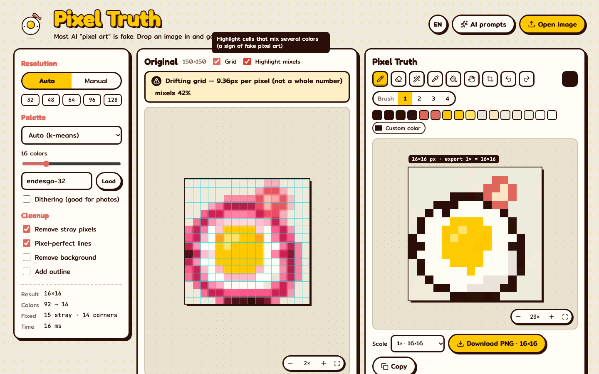

# Pixel Truth

**Turn fake AI "pixel art" into real, grid-aligned pixel art — then bring it to life.**
Runs entirely in your browser: no server, no uploads, no AI image generation. Just signal processing in TypeScript.

**Try it → [pixeltruth.breakfastz.dev](https://pixeltruth.breakfastz.dev)**



By [**breakfastz**](https://www.youtube.com/@breakfastz) — one real product built with AI every week. This is EP.001.

## Features

**Fix AI pixel art**
- Detects whether an image is real pixel art, a drifting (non-integer) grid, or has no grid at all — with a mixel heatmap.
- Rebuilds it one cell → one pixel using the dominant color (no muddy averages), keeping thin ink lines.
- Auto-splits sheets that contain several images (AI loves 3×3 grids) — fix one or download all.
- Palettes: auto (k-means in OKLab), PICO-8, Sweetie 16, Game Boy, or any [Lospec](https://lospec.com/palette-list) slug, optional Floyd–Steinberg dithering.
- Cleanup: stray pixels, pixel-perfect lines, background removal, outline.
- Works on normal images too (illustrations, photos): pick a target width.

**Editor**
- Pencil, eraser, magic eraser, eyedropper, fill, hand; brush sizes; custom + recent colors; undo/redo.
- Zoomable workspace (buttons, Ctrl/⌘ + wheel, pinch) with pan (Space, middle mouse, hand tool).
- Frame tool: resize the canvas, lock a ratio, trim or center the drawing.
- Draw from scratch on a blank canvas.
- Export PNG at 1×–32× or copy to clipboard.

**Sprite to Life**
| Tab | What it does | Export |
|---|---|---|
| Animate | idle squash, auto-detected eye blink, walk (tiny feet), jump | GIF, sprite sheet PNG |
| 3D | puffy voxel model (distance transform), orbit view | `.glb` (Blender, game engines, 3D print) |
| Play | your sprite in a generated platformer level (keyboard + touch) | — |

English and Thai UI (`?lang=th`).

## Getting started

```sh
npm install
npm run dev      # http://localhost:5173
npm run build    # static site in dist/
```

## Deploy

Deployed on Cloudflare Pages from `main` (build `npm run build`, output `dist/`, Node version from `.node-version`).
`public/_headers` sets security and cache headers.

## Scripts

| Command | |
|---|---|
| `npm run dev` | dev server |
| `npm run build` | type-check + production build |
| `npm run lint` | oxlint |
| `npm test` | unit tests (vitest) |
| `npm run e2e` | end-to-end tests (Playwright, builds and serves on :4173) |
| `npm run examples` | re-render the AI-prompt example images in `public/examples/` |
| `./scripts/fetch-samples.sh` | download real-world test images to `tests/fixtures/samples/` |
| `npm run samples` | run the pipeline on those images |

## Project structure

```
src/
  app/          App shell: App, Header, Footer
  components/   reusable UI (PixelCanvas, dialogs, Logo, Thumb)
  features/
    start/      start screen (open / samples / blank canvas)
    convert/    image → pixel art: usePixelTruth hook, settings, original view, sheet split
    editor/     useEditor hook, toolbar, frame tool, export
    life/       Sprite to Life UI (animate, 3D, play)
  lib/          pure, framework-free algorithms (no React, relative imports only)
    pixel/      grid detection, resampling, palettes, cleanup, pipeline, split
    life/       sprite prep, animation, voxels, mesh, platformer physics
    editor/     drawing tools, flood fill, magic eraser, canvas frame math
  i18n/         strings (en/th) and provider
  workers/      pipeline web worker
  config/       site links
  styles/       global CSS
  examples/     procedural example art for the prompt gallery
tests/
  e2e/          Playwright specs
  fixtures/     real-world images (downloaded, not committed)
docs/screenshots/
```

UI code imports with the `@/` alias; `src/lib/` uses relative imports so it can be reused outside this app.

## How it works (`src/lib/pixel/`)

| Step | Where | How |
|---|---|---|
| Clean integer upscale? | `grid.ts` `detectIntegerScale` | every color run length must be divisible by k (with a noise-tolerant pass) |
| Drifting grid | `grid.ts` `detectGrid` | edge profile → peaks → score each period → test divisors to avoid multiples → cross-check axes → snap cut lines to real edges with drift tracking |
| No grid at all | `grid.ts` `estimateBlockSize` | block size from the spacing of strong edges |
| Final cell size | `grid.ts` `interiorNoise` | largest candidate whose cell interiors are still uniform |
| Cell → pixel | `resample.ts` | dominant color per cell; keeps thin dark ink in freeform mode |
| Split sheets | `split.ts` | background from borders → mask → dilate → connected components |
| Palette | `palette.ts` | k-means++ in OKLab, presets, Lospec API, Floyd–Steinberg |
| Cleanup | `cleanup.ts` | orphans, pixel-perfect L-corners, background, outline |

Already-clean pixel art (native or clean integer upscale) is left untouched.

## Credits

Made by [breakfastz](https://www.youtube.com/@breakfastz) · code by [@dolphinep](https://github.com/dolphinep).
License: [MIT](LICENSE). Icons: [Lucide](https://lucide.dev). Test images: see [`tests/fixtures/README.md`](tests/fixtures/README.md).
